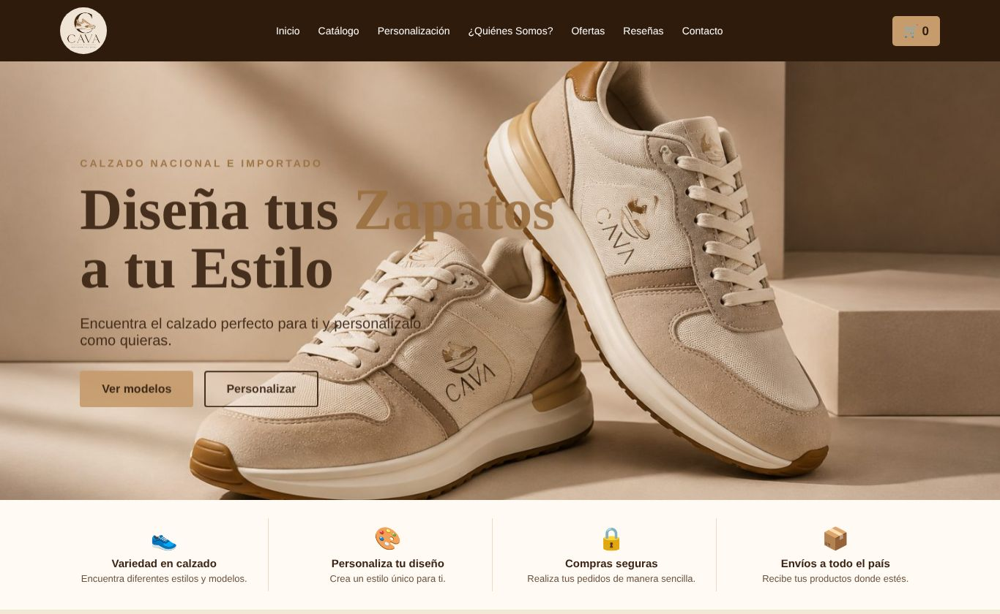

<div align="center">


# CAVA – Calzado cómodo

**Diseña tu paso.** Un sitio pensado para la comodidad de tus pies y con diseño a tu gusto:
encuentra un modelo o crea tu propio estilo.

[](https://luisacastiblanco530-sys.github.io/cava-calzado-comodo/)


</div>



## La empresa

CAVA comercializa calzado nacional e importado en **Pachaquiaro, Puerto López (Meta)**.

## Problemática de la comunidad

La empresa tenía dificultades para mostrar sus productos a las nuevas generaciones porque no estaba vinculada con las nuevas formas de mercadeo por medio de páginas web.

## Funciones principales

| Sección | Qué hace |
|---|---|
| **Catálogo** | Filtros por categoría, buscador (ignora tildes y mayúsculas) y selección de talla. |
| **Configurador** | Modelo, colores de zapato, suela y cordones, material, talla, iniciales o nombre y plantilla ergonómica. Vista previa del zapato y precio en tiempo real. |
| **Carrito** | Cantidades (+ / −) y se conserva al recargar la página. |
| **Pedido** | Envía el resumen completo por WhatsApp. |

## Estructura del proyecto

```
cava-calzado-comodo/
├── index.html        → página principal
├── css/estilos.css   → estilos (colores en :root)
├── js/app.js         → catálogo, configurador, carrito y pedido
├── img/              → logo y fotografías
├── docs/             → captura y registro de cambios
└── .nojekyll         → GitHub Pages publica los archivos tal cual
```

## Verla en tu computador

Descarga el repositorio y abre `index.html` con el navegador. No necesita instalar nada.

## Publicar en GitHub Pages

1. En el repositorio, ir a **Settings → Pages**.
2. En **Source** elegir **Deploy from a branch**, rama `main`, carpeta `/ (root)`.
3. Guardar y esperar uno o dos minutos hasta que aparezca el enlace.

> Cada vez que se cambien `estilos.css` o `app.js`, subir el número de versión en `index.html`
> (`estilos.css?v=3` → `?v=4`, igual con `app.js`). Así los navegadores descargan el archivo nuevo
> y no mezclan el diseño viejo con la página nueva.

## Registro de cambios

Las correcciones y mejoras de la versión 3 están en [docs/CAMBIOS.md](docs/CAMBIOS.md).

## Integrantes

- **Luisa Fernanda Castiblanco Vásquez** – Creadora de la página web y diseño

## Institución

Institución Educativa Santa Teresa de Pachaquiaro (IESTAP)
Media Técnica en Desarrollo de Software – Grado 11 – 2026
